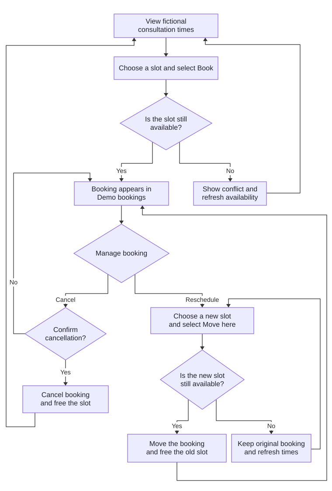
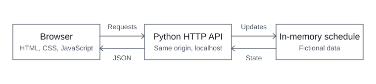

# Campus Appointments

ASK ME began as a team project in Western Illinois University’s graduate Software Engineering course (CS 585) in Spring 2024. This repository builds on that work with a runnable appointment-scheduling demo using fictional data. It shows how a student can find an available consultation time, book it, reschedule, or cancel.

## Student journey



View fictional slots and book a time. From **Demo bookings**, reschedule or cancel. If a slot is taken, the app refreshes availability; an unsuccessful move leaves the original booking unchanged.

## How the demo works



The local browser sends requests to a same-origin Python HTTP API. The API validates and applies changes to the fictional in-memory schedule and returns JSON to the browser.

Booking state resets when the server restarts. The demo does not collect personal or clinical information.

## Original course team

- **Femi Oke** — Product Owner and Project Manager
- Developer (teammate)
- Data Analyst (teammate)

## Run locally

Requires Python 3.10 or later. No packages, accounts, database, or network service are needed.

```sh
python3 app.py
```

Open `http://127.0.0.1:8000/` in a browser. Windows users can run `py -3 app.py` if `python3` is not installed as a command. Use `--port 8001` if port 8000 is already in use. Stop the server with Ctrl+C.

1. Select **Book** next to a fictional appointment time.
2. In **Demo bookings**, select **Reschedule**, then **Move here** at another time. The original time remains booked until the move succeeds.
3. Select **Cancel** and confirm. The time is available again.

## Run the tests

```sh
python3 -m unittest discover -s tests -v
```

The tests cover weekday slot generation, the complete booking lifecycle, conflicting or concurrent bookings, invalid inputs, cross-origin writes, and the static asset allowlist. JavaScript uses native browser APIs; there is no frontend package installation.

## Scope

The browser talks to a same-origin Python API. The server binds to loopback and stores bookings in memory; restarting the server resets the demo. Bookings are shared across tabs on the same local instance. All dates and providers are fictional. The demo does not ask for a name, account, contact details, reason for a visit, or any medical information.

This is not a clinical or emergency service, a production system, or a claim of compliance or adoption. There is no authentication, provider administration, clinical data, database, or notification delivery. Do not connect the demo to real users or services.
